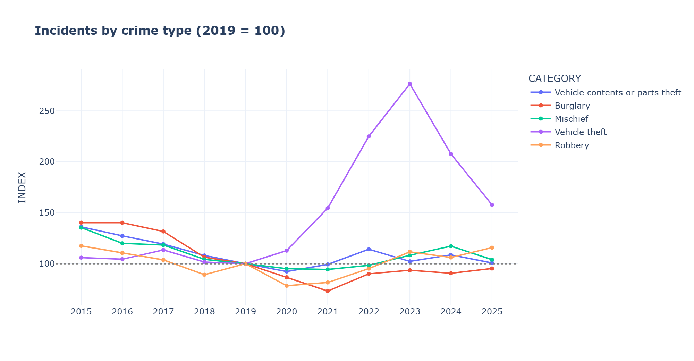
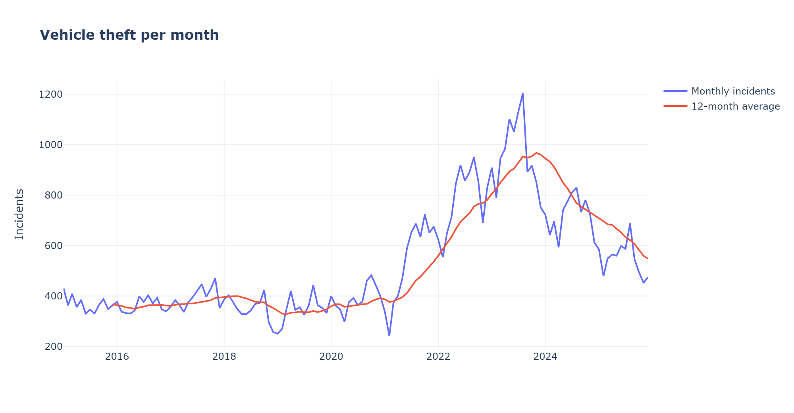
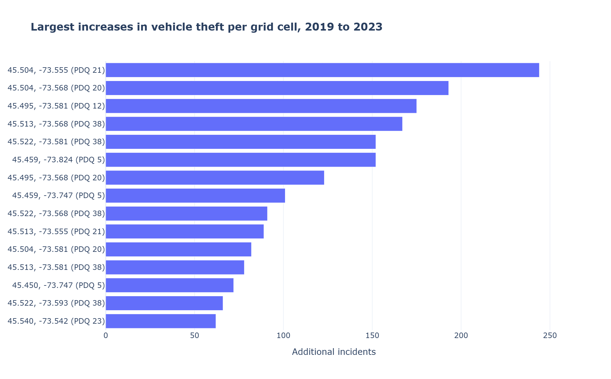

# Montreal Crime After COVID

Did crime in Montreal go back to its pre-pandemic level, and where did it change? An analysis of the open data of the Service de police de la Ville de Montréal (SPVM), 2015 to 2026, with exact confidence intervals, an interrupted time series and a spatial hotspot analysis.



**Interactive results:** [HTML report](docs/report.html) · [hotspot map](docs/map_hotspots.html)
(open the files from a clone of the repository, or enable GitHub Pages on the `docs/` folder)

## Key findings

All figures are computed by the notebook from the data (file updated up to 22 November 2026). They change when the data is downloaded again, because the portal updates the file daily.

- **Volume:** 29,832 incidents reported in 2025 against 27,155 in 2019 (+9.9%, 95% interval +8.1% to +11.7%). The lowest year is 2020 (25,460).
- **Rate per 100,000 residents:** 1,331 in 2021, 1,669 in 2023 and 1,373 in 2025. Population is only available from 2021 for now (see "Population" below).
- **Where crime stands against 2019, in 2025:** vehicle theft +58% (95% interval +52% to +64%), robbery +16% (+9% to +23%) and mischief +4% (+0.4% to +7.7%) are above 2019 by more than random variation; burglary is below (-4.7%, -7.9% to -1.5%); vehicle contents or parts theft is unchanged (+0.7%). Mischief is a borderline result, since five categories are compared at once.
- **Vehicle theft is the category that moves differently:** 4,170 in 2019, a peak of 11,528 in 2023 (+176%), then 6,579 in 2025. The peak month is August 2023.
- **COVID:** no clear level change in total monthly incidents in March 2020 (-1.5%, 95% CI -17.5% to +17.7%); categories differ (burglary -22%, robbery -20%), and vehicle theft is a poor fit for a March 2020 break because its surge comes later.
- **Where:** the largest increase in vehicle theft between 2019 and 2023 is in the 1 km cell centred on 45.504, -73.555 (+244 reports). The top cells stay mostly the same with 500 m cells (80% overlap) and less with 2 km cells (53%). Getis-Ord Gi* flags 23 hotspot cells in 2023 and 61 in 2019; this counts clusters, not growth.
- **Concentration:** the busiest 1% of intersections hold 9.8% of located incidents in 2025 (7.8% in 2019, 11.1% in 2023); the Gini coefficient goes from 0.41 in 2019 to 0.47 in 2023 and 0.46 in 2025.
- **Reporting patterns:** reports of vehicle theft on Saturday and Sunday went from 11.4% and 10.2% (2015-2019) to 13.3% and 14.3% (2022-2025). These are patterns of when incidents are reported, not of when they happen.
- **2026 so far (January to October):** -2.8% vs 2025 and +8.6% vs 2019; vehicle theft is -6.9% vs 2025 but still +51% vs 2019.

### Vehicle theft




## Data

SPVM, *Actes criminels*, Ville de Montréal open data portal (CC-BY 4.0): 366,066 rows from 1 January 2015 to 22 November 2026. Nothing is dropped silently:

- no row was dropped for an invalid date or an unrecognised category;
- 11,314 exact duplicate rows (3.1%) are counted but kept, because the file has no incident identifier;
- 61,168 rows (16.7%) have no usable position; they stay in the counts but not on the maps;
- the number of police stations (PDQ) goes from 34 in 2015 to 29 in 2025, so the geographic analysis uses a regular grid instead of PDQs.

## Method

- Counts with exact Poisson (Garwood) 95% intervals; change between years with a rate-ratio interval; year-over-year change and compound annual growth rate (CAGR).
- Interrupted time series on log monthly counts (trend, level and slope change, month dummies, Newey-West errors).
- Square grid in metres (EPSG:2950) with a sensitivity check on cell size (500 m, 1 km, 2 km); Getis-Ord Gi* hotspots with Benjamini-Hochberg correction; Gini and HHI concentration.
- Data quality report: duplicates, missing and out-of-territory positions, and how unevenly positions are missing by year, crime type, month and police station.
- Comparison of the same calendar months across years, and a year-to-date comparison for 2026.

## Limitations

- The data counts incidents **reported** to the police; date and time are those of the report, not of the offence.
- About 17% of incidents have no usable position, unevenly by crime type and police station (7% for burglary to 22% for vehicle contents theft in 2025; over 29% in PDQ 20 and 21). Maps understate the real counts, especially in those areas.
- A single break in March 2020 is a crude description of some series. Residuals are strongly autocorrelated (Durbin-Watson 0.47 for total incidents, 0.26 for vehicle theft), and the fitted line overshoots the observed counts in 2024-2025 because a straight trend cannot follow a rise and a fall; read the time series estimates as indicative.
- The results show temporal associations, not proof that the pandemic caused them.
- Five categories are compared at once: an interval bound close to 0 (mischief) should be read as borderline.
- Poisson intervals assume independent incidents and treat the population as known, so they understate the real uncertainty.
- "Offenses causing death" includes manslaughter and criminal negligence, not only murder, and is too rare (24 to 39 per year) for percentage trends.

## Population

Rates per 100,000 residents use the population of the administrative region of Montréal (the island), from the Institut de la statistique du Québec, in `reference/population_montreal.csv`. The file currently covers 2021 to 2025; 2015 to 2020 are still to be added, so rates and the 2019 comparison per resident are not shown yet.

## Project structure

```
Montreal-Crime-After-COVID.ipynb   the analysis (run top to bottom)
crime_utils.py                     tested functions used by the notebook
download_data.py                   downloads the data from the open data portal
reference/population_montreal.csv  population by year
tests/                             pytest tests (53)
.github/workflows/tests.yml        runs the tests on every push
data/                              downloaded data (not versioned)
docs/                              HTML report and map
images/                            figures used in this README
```

## Reproduce

```powershell
pip install -r requirements.txt
python download_data.py
jupyter notebook Montreal-Crime-After-COVID.ipynb   # Restart & Run All
```

Tests: `pip install -r requirements-dev.txt` then `pytest`. The development requirements include `kaleido`, used by the last cell of the notebook to save the figures of this README. CI runs the tests on Python 3.11 to 3.13. Developed with Python 3.14, pandas 3, numpy 2.

Plotly is pinned below version 7 in `requirements.txt`: in the exported HTML report, Plotly 7 does not draw the circles of the maps over the map tiles.

To export the report (the charts and maps load Plotly and the map tiles from the internet, so open it online): `jupyter nbconvert --to html --execute --ExecutePreprocessor.timeout=900 --output-dir docs --output report Montreal-Crime-After-COVID.ipynb`. Without `--execute` the charts are missing.

## Technologies

Python, pandas, numpy, scipy, statsmodels, pyproj, shapely, plotly, folium, kaleido, pytest, GitHub Actions.

## Sources

- SPVM, *Actes criminels*, Ville de Montréal open data portal (CC-BY 4.0): https://donnees.montreal.ca/dataset/actes-criminels
- Ville de Montréal, *Limites administratives de l'agglomération*.
- Institut de la statistique du Québec, population estimates.